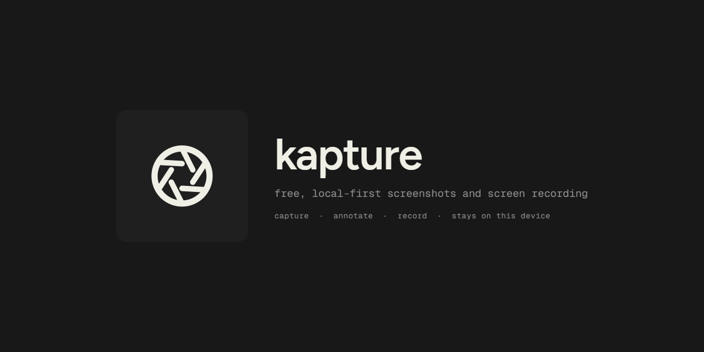
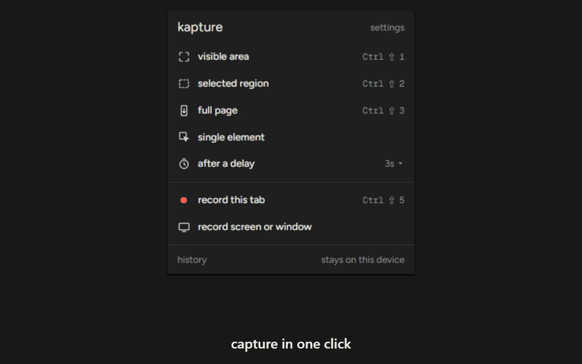

# Kapture



Free, local-first screenshots and screen recording. No account, no cloud, no watermark — captures stay on your device until you choose to export.



## Features

- **Capture everything** — visible area (`Ctrl/Cmd+Shift+1`), selected region (`+2`), full page (`+3`), single element, delayed capture, tab and screen recording (`+5`)
- **Annotate** — arrows, boxes, blur, numbered steps, crop, undo/redo, all in the editor that opens after every capture
- **Library** — grid, search, folders, auto-cleanup; history lives in on-device IndexedDB
- **Record** — tab audio plus optional mic, saved as MP4 when supported or WebM otherwise, with an in-page stop/discard bar
- **Private by design** — no account, no analytics, on-device everything

## Install

Load the unpacked extension (Chrome → `chrome://extensions` → Developer mode → Load unpacked):

```bash
pnpm install
pnpm build
# load .output/chrome-mv3/
```

## Use

Click the toolbar icon or use the shortcuts above. Captures open in the editor; everything is saved to the library (popup → history). Full shortcut list: [docs/capture-modes](site/src/content/docs/capture-modes.md).

## Develop

```bash
pnpm dev              # WXT dev server with HMR
pnpm compile          # typecheck (tsc --noEmit)
pnpm test             # unit tests (vitest)
pnpm test:e2e         # E2E (Playwright, needs pnpm build first)
pnpm build:site       # landing page → site/dist/
```

See [AGENTS.md](AGENTS.md) for architecture notes (WXT entrypoints, typed message bus, MV3 constraints). Changelog: [site/src/content/changelog](site/src/content/changelog/).

## Privacy

Screenshots, recordings, tab titles and URLs, annotations, and folders are stored locally in your browser. Kapture does not upload capture data; copying or downloading happens only when you choose it. Details: [docs/privacy](site/src/content/docs/privacy.md).

## License

Apache-2.0. See [LICENSE](LICENSE).
